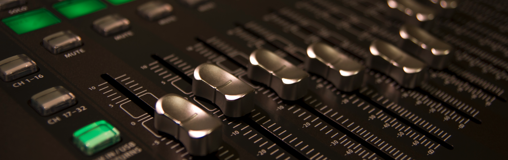

# Exercise 6 - Event Add-On for ERP - Event Studio Deep Dive

After completing these steps you will have created your own custom event payload in the SAP backend using Event Studio: a CDS payload based on SalesOrder, an event linked to it, and a deployed interface that sends your events to Advanced Event Mesh. You consume the events with the Try Me! tool.

> [!NOTE]
> This is a deep dive topic. It assumes you have completed at least [Exercise 1](../ex1/README.md) and know how to connect the TryMe! tool to your broker.

## User Data and Password

In order to log into Event Studio, you can use the below email address with XXX replaced with your group number.

teched_xxx@asapio.com (e.g. teched_001@asapio.com)

The password will be provided to you by the moderators.

Later in the exercise the Custom CDS app asks for a backend login. Use the user `teched<usernumber>` (e.g. `teched001`), client `100`, and the password provided by the moderators.

## Exercise 6.1 Learn about Event Studio and the Scenario

The Event Add-On for ERP brings event-driven capabilities to SAP S/4HANA and other ABAP-based backends. <b>Event Studio</b> is its cockpit for designing events: you define <b>what</b> an event contains (the payload), <b>when</b> it is raised (the event), and <b>where</b> it is sent (the connection and topic on the event broker).

In this exercise you do the following:

1. You create a <b>CDS payload</b> on top of the SalesOrder data. It defines your custom payload - you decide which fields are in and which are out.
2. You create an <b>event</b> on your payload that fires whenever a SalesOrder is changed.
3. You <b>deploy</b> the event as an interface that sends the event to Advanced Event Mesh, using a topic that contains the SalesOrder number.
4. A <b>report</b> in the system updates a SalesOrder <b>every 2 minutes</b>. Each update raises an event, which is sent with <b>your</b> payload.
5. You consume your events in AEM using the <b>Try Me!</b> tool.

[Insert diagram: SalesOrder change -> Event Studio event -> CDS payload -> Connection -> AEM topic -> Try Me!]

> [!IMPORTANT]
> You do not need ABAP or CDS experience. Everything is done in the Event Studio UI.

## Exercise 6.2 Open Event Studio and Create your CDS Payload

1. Open <b>Event Studio</b>: https://url.sap/p1ueid

2. When asked for the identity provider, choose the <b>first</b> one.

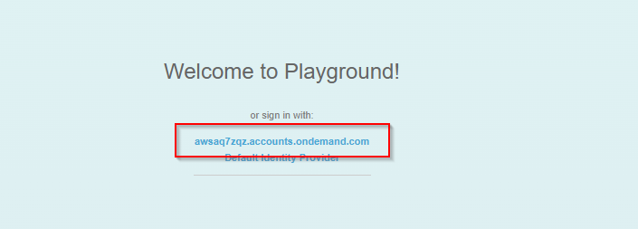

3. Select the system <b>DS4_PP</b> and click <b>OK</b>.

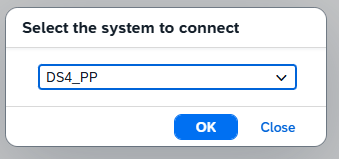

You start on the <b>Data Objects</b> screen. It lists the payloads that are available, for example the ASAPIO standard payloads for PurchaseOrder, BillingItem or CompanyCode.

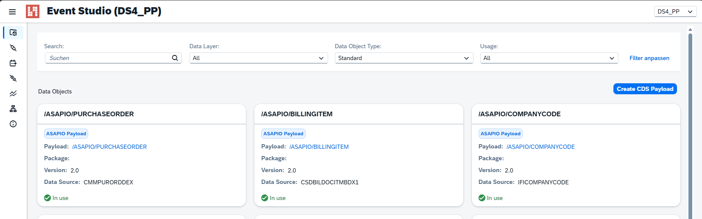

4. Click <b>Create CDS Payload</b>.

5. Fill out the form:

   - <b>Name</b>: `ZZ1_TECHED_<name>_<usernumber>`, replace `<name>` with a short name of your choice and `<usernumber>` with your participant number, e.g. `ZZ1_TECHED_EXAMPLE_001`
   - <b>Label</b>: a description of your choice, e.g. Demo for TechEd
   - <b>Data Source</b>: <b>I_SalesOrder</b>
   - <b>Scenario</b>: <b>STD (Standard)</b>

6. Click <b>Create</b>.

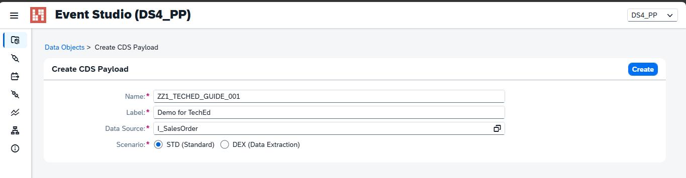

7. A pop-up confirms that the Custom CDS has been created. Click <b>Go to Custom CDS app</b>.

8. When asked to log in, use the backend user `teched<usernumber>` (e.g. `teched001`) with the password provided by the moderators. Keep client <b>100</b> and choose your language.

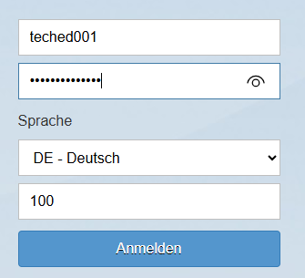

## Exercise 6.3 Define the Payload Content

You are now in the Custom CDS app, in the details of your CDS view. The steps at the top (Data Sources, Parameters, Elements, ...) guide you through the definition. The data source <b>I_SalesOrder</b> is already set.

1. Click <b>Edit</b> at the bottom of the screen.

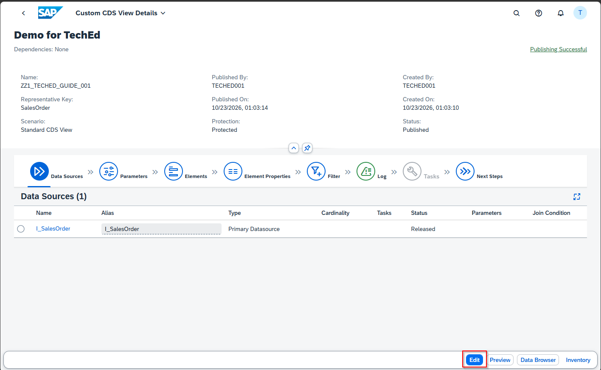

2. Go to <b>Elements</b>. This is the list of all fields in your payload.

3. To add fields to your payload, click <b>Add</b> above the list of elements and choose <b>Elements</b>.

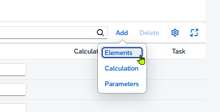

4. The <b>Select: Elements</b> dialog opens. Select the fields you want to add to your payload. Fields of associated entities (for example `_Item` for the SalesOrder items) are listed below the main data source I_SalesOrder. The fields you have selected are shown under <b>Selected Items and Conditions</b>. Click <b>OK</b>.

> [!TIP]
> Keep <b>Show Used</b> on <b>No</b> to see only the fields that are not yet part of your payload.

5. The new fields appear in the list of elements. After your changes the view is in status <b>Draft</b> / <b>Changed</b>. Click <b>Publish</b> at the bottom to save and activate the view and release it for further use.

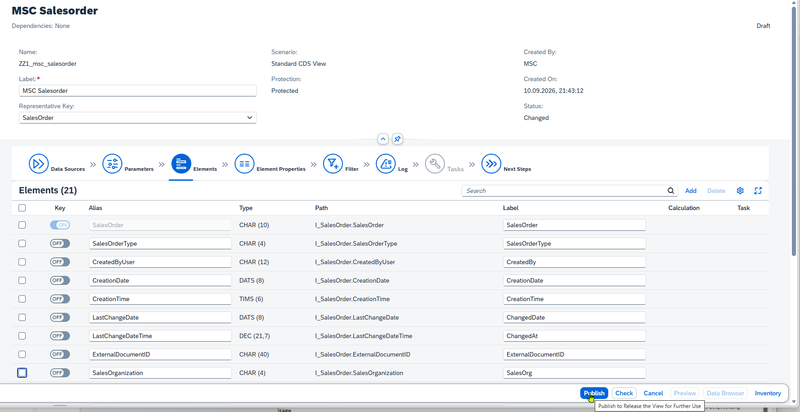

> [!TIP]
> Keep your first version small. You can come back and change it later.

6. For now we can ignore the warning messages and just click **Close** to dismiss the dialog.

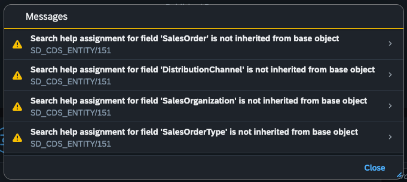

7. Verify that the CDS view has been successfully published.

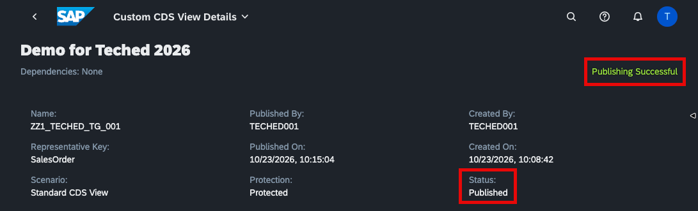

## Exercise 6.4 Create an Event for your Payload

1. Switch back to the **EVent Studio**. Go back to <b>Data Objects</b> (breadcrumb at the top) and enter <b>teched</b> into the search field. You find the payloads of all participants. Open <b>your</b> payload, identified by your participant number.  
Your payload is marked as <b>CDS Payload</b> and is <b>Not in use</b> yet.

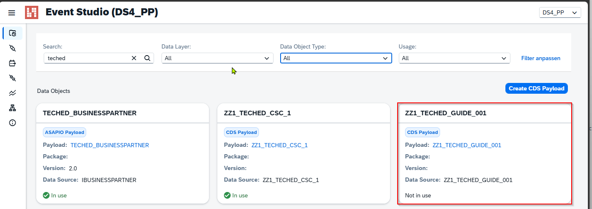

> [!TIP]
> Use the `Search` field to quickly find your data object. 

2. In the <b>Events</b> tab, you see that no event exists yet. Click <b>Create Event</b>.

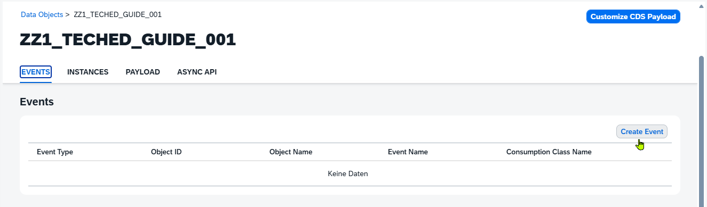

3. Enter the following values and click <b>OK</b>:

   - <b>Payload</b>: your payload (pre-filled)
   - <b>Payload Version</b>: leave empty
   - <b>Event Type</b>: <b>RAP Business Object</b>
   - <b>Object ID</b>: <b>SalesOrder</b> *(it is not in the drop-down, just enter it as text)*
   - <b>Event Name</b>: <b>Changed</b>

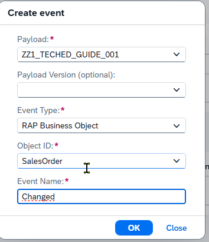

4. A message confirms that the event was created. Click <b>OK</b>. The event now shows up in the list, with a <b>Deploy</b> link on the right.

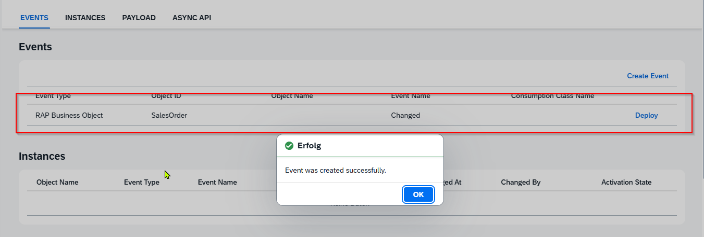

## Exercise 6.5 Deploy the Event to Advanced Event Mesh

1. Click <b>Deploy</b> next to your event. The <b>Deployment settings</b> open.

2. Check or enter the following values:

   - <b>Interface Name</b>: pre-filled based on your payload name, no change needed
   - <b>Connection</b>: <b>TECHED (SOLACE)</b>
   - <b>Header Fields</b>: keep the default selection and fill the **Value** fields:
     - POST
     - application/json
     - Persistent
     - /sap.com/teched/001/fallback  The `SOLACE_TOPIC`</b>` header is the fallback topic used if the dynamic topic cannot be built
   - <b>Solace Dynamic Topic</b>: build the topic from the segments <b>sap.com / teched / &lt;usernumber&gt; / { I_SalesOrder.SalesOrder }</b>, e.g. <b>sap.com / teched / 001 / { I_SalesOrder.SalesOrder }</b>. Replace the number with your participant number. The last segment is a field of the payload, so each SalesOrder is sent to its own topic.
   - <b>Load Type</b>: <b>Incremental Load</b>
   - <b>Activation</b>: checked

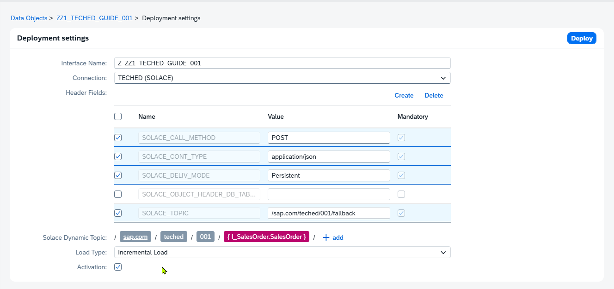

> [!TIP]
> The configuration of the `Solace Dynamic Topic` is done in multiple steps.
> 

> 
Expand this section for step by step instructions

>
> 1. Click the `+ add` button
>
> 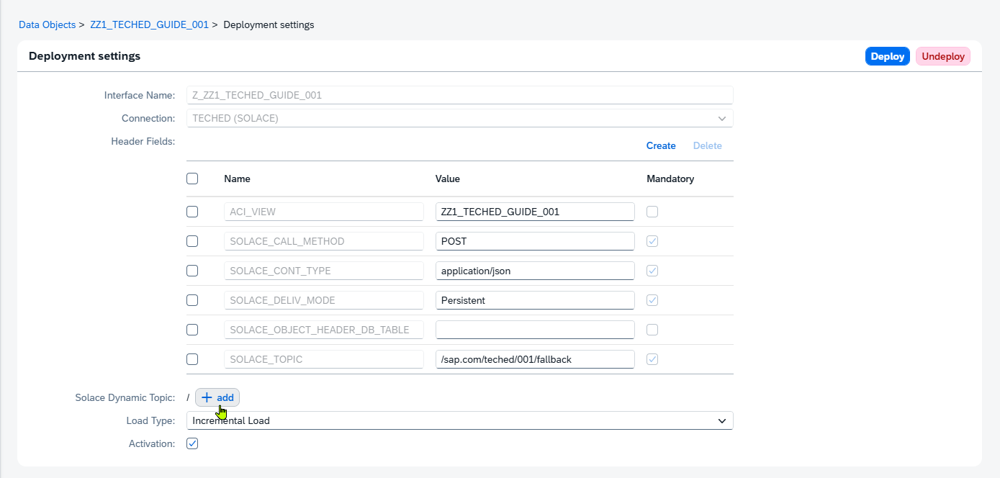
>
> 2. Select `bla` provide `sap.com` and click `save`.
>
> 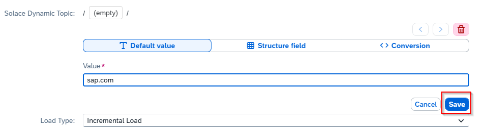
>
> 3. Repeat steps #1 and #2 to add segments
> - teched
> - \<usernumber\> 
>
> 4. To add the final *dynamic* segement select `blub` and provide
> - I_SalesOrder
> - SalesOrder
>
> 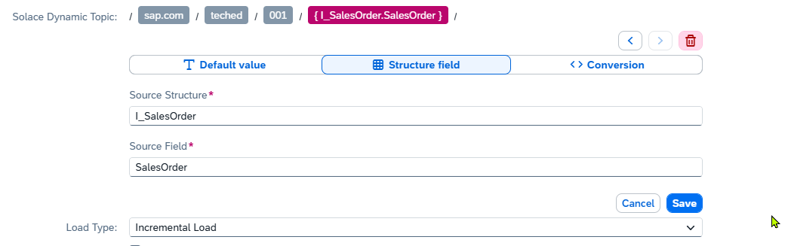
> 
> 
  

3. Click <b>Deploy</b>.

4. Go back to your payload and open the <b>Instances</b> section. You now have an entry for your event with the activation state <b>Deployed</b>.

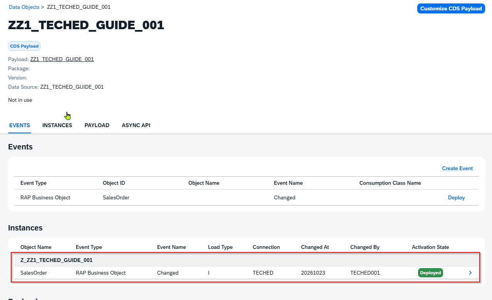

The interface is now deployed and active.

## Exercise 6.6 Consume your Events in AEM

The report that updates a SalesOrder runs every <b>2 minutes</b>. Each update raises a <b>Changed</b> event for the SalesOrder, and your interface sends it to AEM with your custom payload.

1. Open the <b>Try Me!</b> tool in your AEM broker as you did in [Exercise 1.4](../ex1/README.md#exercise-14---send-an-event-from-the-try-me-tool-to-your-topic) or as documented in [Exercise 7.4.3](../ex7/README.md#743---testing-your-micro-integration-flow).

2. Connect the <b>Subscriber</b> and subscribe to the topic you have configured. Use a wildcard for the SalesOrder number: `sap.com/teched/<usernumber>/>`, e.g. `sap.com/teched/001/>`

3. Wait for the next run of the report. Your events arrive in the Subscriber.

[Insert screenshot: Try Me! Subscriber showing a received payload]

4. Compare the payload with the fields you selected in your CDS payload. Does it look like what you intended?

## Exercise 6.7 Change your Payload (Optional)

1. Go back to the Custom CDS app, add or remove a field in your payload, and save / release it again.
2. Wait for the next event and check in Try Me! that the payload has changed.

## Summary

You have created a custom event payload based on SalesOrder, linked it to an event with Event Studio, deployed it to Advanced Event Mesh, and consumed live events with it. This is how business teams can make their own events available - the "Event-Driven Hockey Stick" from [Exercise 5](../ex5/README.md) in practice.

 - Go back to the main page - [Main Page](../../README.md)
