# Exercise 7 - Building a Micro-Integration to publish files onto your Mesh

SAP Integration Suite, advanced event mesh supports a range of protocols that enable applications to publish events to Event Brokers or consume events from them. 
These protocols include AMQP, MQTT, JMS, HTTP(S) (including REST Delivery Points to push events to REST APIs), Solace Messaging Format (SMF, high-performance binary messaging protocol over TCP), <a href="https://help.pubsub.em.services.cloud.sap/Cloud/Security/security-client-connectivity.htm?#default-port-and-protocol-configuration-for-messaging-connectivi" target="_blank">more</a>.

Advanced Event Mesh supports automatic protocol conversion, meaning that publishing and subscribing applications do not need to use the same protocol.

Beyond protocol-based messaging, Advanced Event Mesh also offers <a href="https://help.pubsub.em.services.cloud.sap/Micro-Integrations/Managed/create-micro-integration-details.htm" target="_blank">Micro-Integrations</a> .

Micro-Integrations provide **lightweight integration functionality** that connects external systems directly to Advanced Event Mesh, enabling them to participate in Event-Driven data distribution.
These external systems include enterprise applications, LLMs & AI Agents, messaging services, data stores, file servers, etc. 
Depending on the Micro-Integration, data can flow from an external system onto the mesh or from the mesh to an external target.

**Lightweight** is a key characteristic of Micro-Integrations.
They are particularly well suited to focused, high-volume integration scenarios that require little or no transformation or processing, such as event streaming.

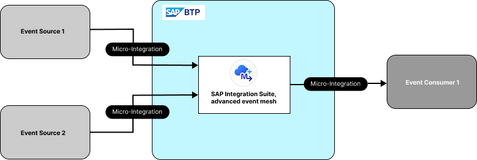

In this exercise, we will explore Micro-Integrations by building a flow that publishes files from an SFTP server to topics and queues on your Event Broker. 
Whenever a new CSV file is placed on the SFTP server, each line will be published as a separate JSON event to the mesh, ready for subscribers to consume at their own pace.

After completing these steps, you will be familiar with the structure, configuration and deployment of Micro-Integrations in SAP Integration Suite, advanced event mesh.

Before diving into the hands-on part, let's discuss some of the potential use cases.

## 7.1 - Micro-Integration Use Cases

In this section, we will outline some of the potential use cases for Micro-Integrations on SAP Integration Suite, advanced event mesh. 

Note that the use cases we will discuss will often involve one specific source or target system. 
In reality, a source system will be posting events on the event broker and multiple applications will consume these events. 
This means that Source Micro-Integrations (MIs that enable source systems to publish events on the mesh) will often publish on a topic where multiple queues are subscribed to.
Target Micro-Integrations can be one of the receivers as they will often listen to a specific queue and publish to a specific target system.

## 7.1.1 - Non-SAP Enterprise Applications as publishers or subscribers

Not all enterprise applications can be configured to publish or consume events directly. Some applications work natively with events but only expose them through their own publish/subscribe APIs.
In that case, you still need lightweight integration logic to subscribe to these APIs and forward events to the event broker, or to retrieve events from the event broker and publish them through the application's API.

Looking at the non-SAP world, Salesforce is a good example of this. 
Its Pub/Sub API lets you subscribe to Salesforce events (such as Change Data Capture events and Platform Events) and publish Platform Events back into Salesforce. 

So, you may be wondering:
- "How do we get Salesforce events published to our topics and queues in AEM?"
- "How do we publish events from AEM back to Salesforce through this Pub/Sub API?"

Well, you probably guessed it by now: the answer is Micro-Integrations.

AEM offers a Salesforce Micro-Integration that leverages the Salesforce Pub/Sub APIs and works in both directions: you can use it to get Salesforce events onto the topics and/or queues you specify, or to send events from AEM back to Salesforce.

Below, an example of what such a Micro-Integration looks like. In this example, the Micro-Integration subscribes to Salesforce events through the Pub/Sub API. Whenever an event occurs (e.g., an Account change event), the Micro-Integration publishes it to a topic or queue on the event broker service named "us1".

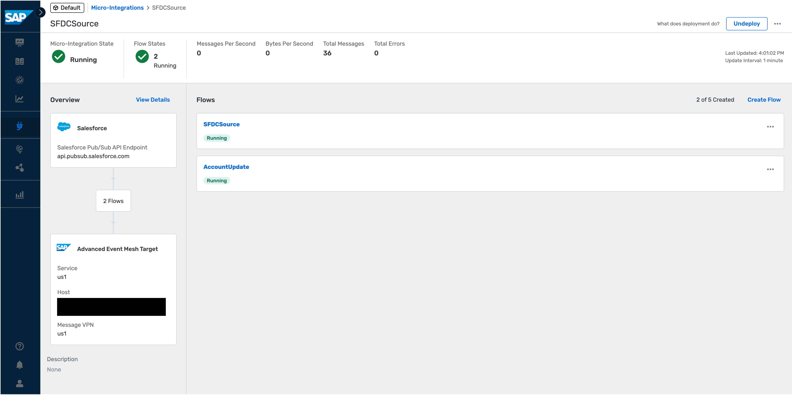

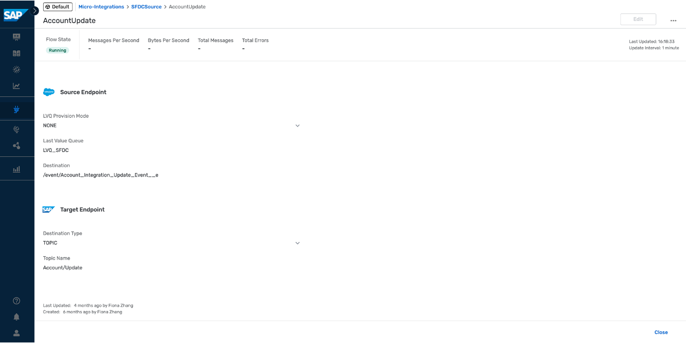

In case: 
1. one of your applications cannot natively receive events
2. there is no Micro-Integration available, but it natively offers public REST APIs
3. you don't need to transform the event

You can also leverage <a href="https://help.pubsub.em.services.cloud.sap/API/REST/REST-Consumers.htm#rest-delivery-point" target="_blank">REST Delivery Points</a> (RDP's) in AEM. 
An RDP delivers events from a queue to a REST endpoint as HTTP requests, effectively acting as an outbound webhook. The endpoint only needs to be reachable from the event broker service. For the opposite direction, any application that can send HTTP requests can publish events directly to the event broker through its REST messaging interface.

## 7.1.2 - Content-Based Topic Destinations and Lightweight Transformations

One of the strengths of Advanced Event Mesh is the fine-grained and flexible filtering using wildcards in topic subscriptions.
This makes the platform very flexible, as it allows a single subscription to attract events published on many different topics.

For example, 
- **salesorder/created/>** matches all sales order created events, no matter how many levels follow the verb.
- **businesspartner/*/de/>** matches all events on German business partners, regardless of whether the business partner was created, updated, etc.

A <a href="https://help.pubsub.em.services.cloud.sap/API/REST/REST-Consumers.htm#rest-delivery-point" target="_blank">well-designed topic</a> typically follows a noun/verb/properties structure, and defining a reusable topic taxonomy is key when setting up event-driven architectures.

However, an application cannot always control the topic it publishes its events on. Take Salesforce again: its event channels are defined by the Salesforce Pub/Sub APIs, so most likely it is not following your exact topic taxonomy.

This is where the Content-Based Topic Destinations (also referred to as Smart Topic Destinations in AEM) come in. 
They allow you to combine fixed values (e.g., salesorder/created) with fields from the incoming event's payload or headers (e.g., region, country, or supplier ID), so that each event is published to a topic that follows your topic taxonomy.

You define a Smart Topic Destination in the Mappings step of a Micro-Integration. Below is an example of the one we will build later in this chapter.

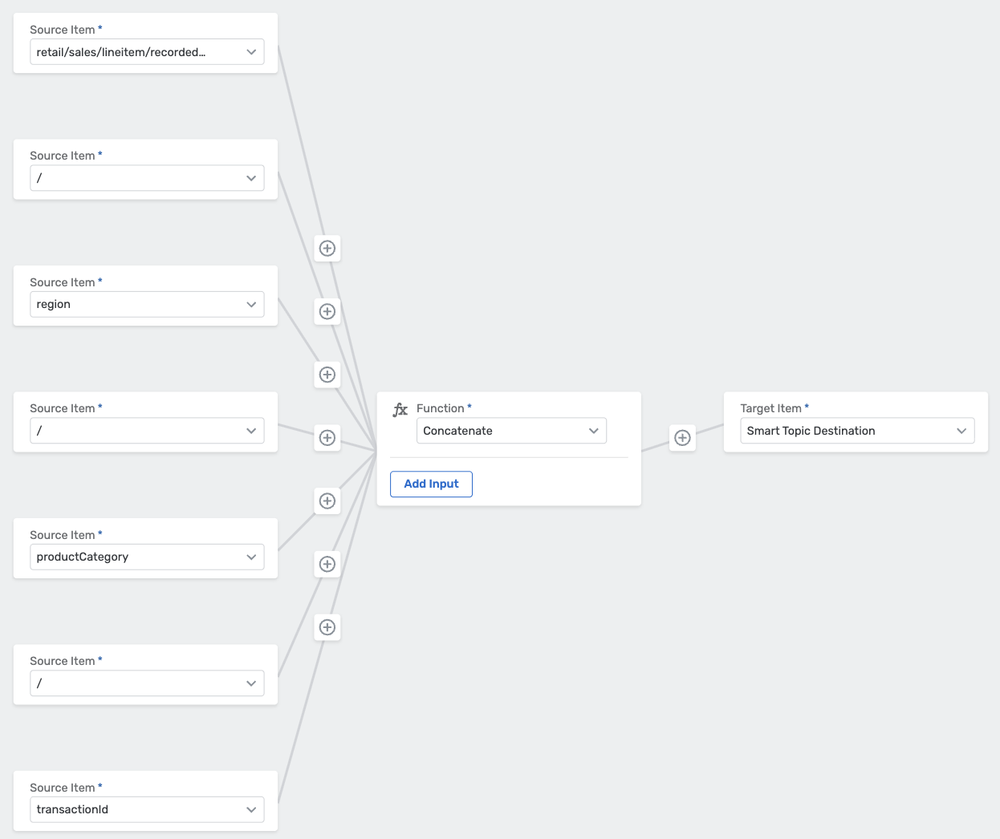

Micro-Integrations also come with the option to perform lightweight transformations when events are coming in or going out.
For example, sometimes you may want to remove, map or mask one or more fields from the payload before it's published on topics or in queues or before you send it to a specific target. This is where the lightweight transformation capabilities of the Micro-Integrations come in.

## 7.1.3 - Event Streaming

Event streaming refers to a continuous, real-time flow of events, often at high volumes. This is common in IoT scenarios: sensors capturing the vibrations of machines or engines, for example, can generate thousands of events every second. These events are often streamed directly to databases, data lakes, or data warehouses. This doesn't require complex integration logic, but it does require moving large volumes of events reliably. AEM includes Micro-Integrations for several data stores, such as MongoDB and PostgreSQL, that you can use for this purpose. 
A Micro-Integration for SAP HANA Cloud is also planned, which will allow you to stream events into SAP HANA Cloud or SAP Business Data Cloud.

Note: roadmaps are subject to change.

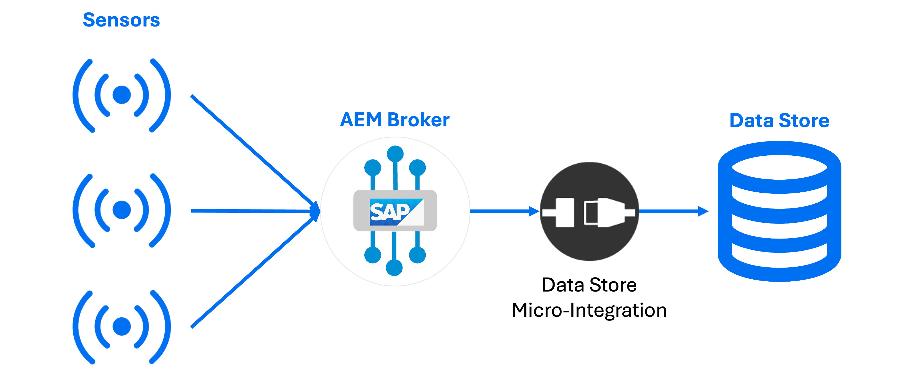

## 7.1.4 - Change Data Capture

We previously discussed how Micro-Integrations can push events directly into a data store, but the other way around is also possible. With Change Data Capture (CDC), a Micro-Integration listens for changes in a database (inserts, updates, and deletes), whenever a change occurs, it publishes it as an event to a topic on the mesh. AEM comes with CDC Micro-Integrations for various databases, such as Oracle, Microsoft SQL Server, IBM Db2, MySQL, PostgreSQL, and MongoDB. They capture changes from the database's transaction log instead of repeatedly querying its tables, so the source application doesn't need to be changed. 
A CDC Micro-Integration for SAP HANA is also planned, which will allow you to publish changes in SAP HANA/BDC as events to AEM.``

Note: roadmaps are subject to change.

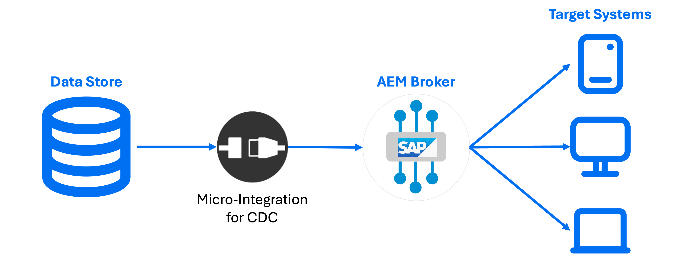

## 7.1.5 - LLM Processing

An event is often a good input for a large language model (LLM), for example to classify a support ticket, summarize a document, or extract structured data from free text. The LLM's response can then be captured as a new event, which in turn serves as input for other applications. 
You can use a Processor Micro-Integration for this. It forwards events from the event broker to an LLM and publishes the LLM's response back to the event broker, ready for consumption by other systems.

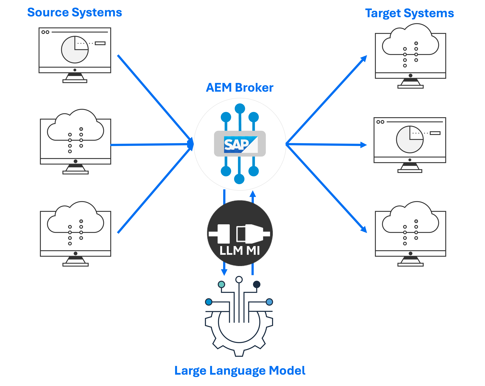

## 7.1.6 - File-to-Mesh

Another typical use case for Micro-Integrations is File-to-Mesh: a Micro-Integration picks up files from a file server (e.g., an SFTP server) and publishes their contents to the mesh, making them available for event-driven distribution to all interested applications. Because many legacy applications still rely on SFTP to exchange data, this is a common way to integrate them into an event-driven architecture (often referred to as liberating legacy applications). The reverse is also possible: a target Micro-Integration can write events as files to a file server.

In this exercise, you will build a File-to-Mesh scenario that also uses Content-Based Topic Destinations.

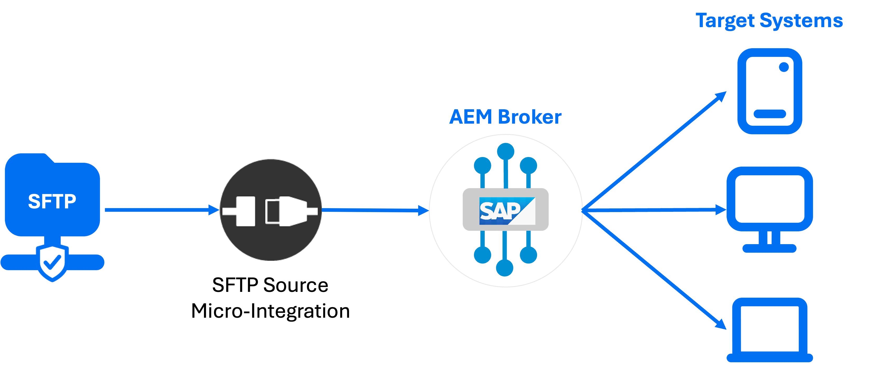

## 7.2 - Exploring Micro-Integrations

Now that you have a better understanding of potential use cases, let's have a look at the Micro-Integrations that are currently available in SAP Integration Suite, advanced event mesh:

1. In the Advanced Event Mesh Cloud Console, scroll down to the section "**Micro-Integrations**" and click on the tile "**Micro-Integrations: Create and manage Micro-Integrations**".

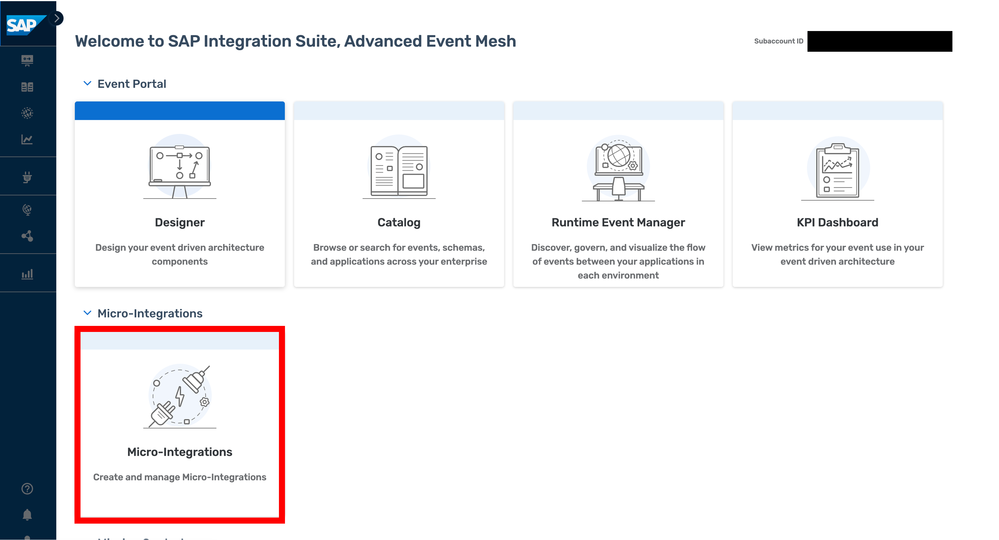

2. This takes you to an overview of all Micro-Integrations that are configured in your environment. You can also see the deployment/error status of each MI (e.g. Not Deployed, Deployed, Down, etc.).
3. If you want to see the list of all Micro-Integrations that can be configured on Advanced Event Mesh, click on "**explore our full list of available Micro-Integrations**".

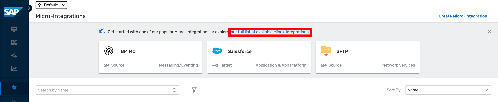

4. This opens a list of all available Micro-Integrations. As you can see, they support integration with a range of systems and services, including:
* **Databases and Data Warehouses**: 
PostgreSQL, MySQL, Oracle DB, MongoDB, IBM DB2, and others.
* **File and Object Stores**: 
SFTP, Amazon S3, Azure Blob Storage, and others.
* **Enterprise Applications**: 
Salesforce, for example.
* **Messaging Services**: 
Amazon SNS, Amazon SQS, Azure Service Bus, Google Pub/Sub, IBM MQ, and others.

You will see three different types of Micro-Integrations:
* With a **Target MI**, data streams _from an advanced event mesh event broker service_ to the external system.
* With a **Source MI**, data streams _from the external system_ to an advanced event mesh event broker service.
* With a **Processor MI**, data streams from an advanced event mesh event broker service, through a transformation, and back to that same event broker service.

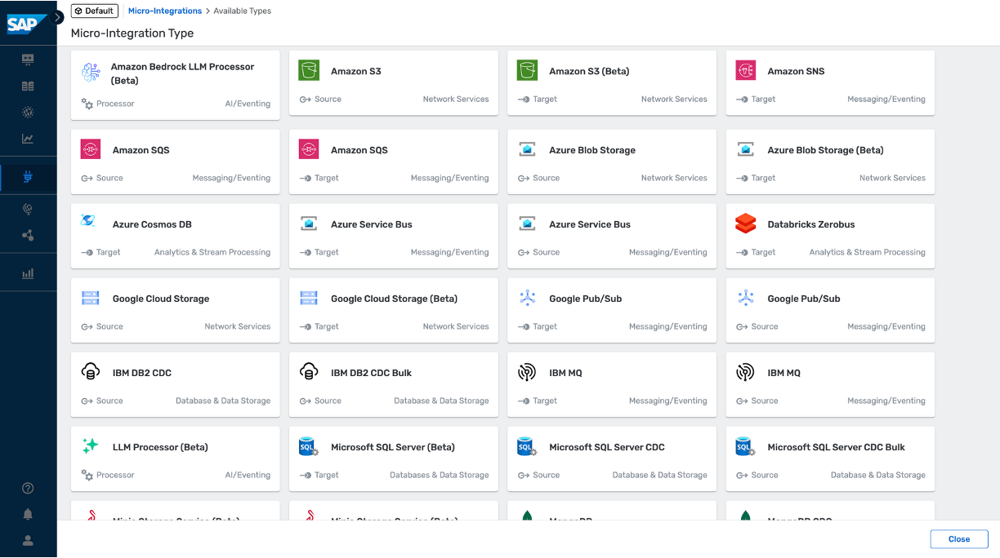

Selecting a Micro-Integration from this list starts the process of creating a new instance. **We are not going to create a Micro-Integration for this exercise**. Instead, we will create a flow (explained later in the exercise) within an existing MI. 

For now, take a moment to familiarise yourself with the available Micro-Integrations before moving on to the next part of the exercise.
You can also find a list of all available Micro-Integrations <a href="https://help.pubsub.em.services.cloud.sap/Micro-Integrations/Managed/create-micro-integration-details.htm" target="_blank">here</a>.

## 7.3 - Getting familiar with the structure of a Micro-Integration

1. Return to the overview of all configured **Micro-Integrations**.

2. Search for the following Micro-Integration: **IN163_SFTP_Sample**

3. Open this SFTP Source Micro-Integration.

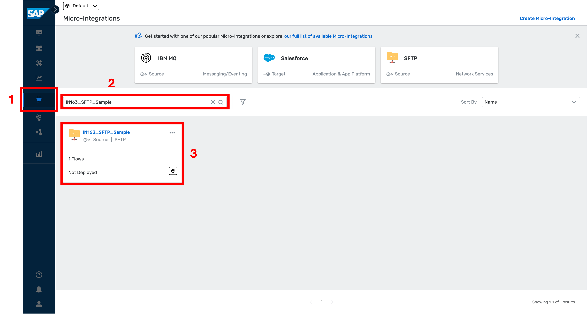

4. At the top of the page, you see the state of the Micro-Integration. Below it, the page provides an overview of the source and target connection details on the left and the configured flows on the right. Under the connection details, click "**View Details**".

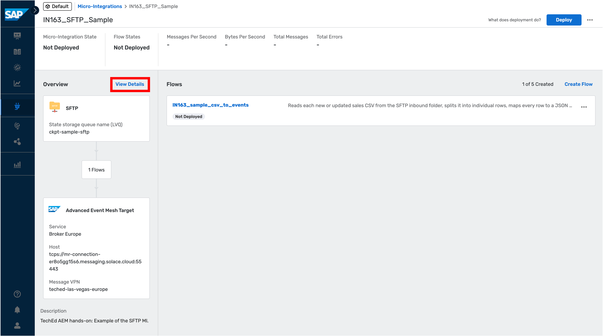

5. Here, you can inspect the connection configuration for your Micro-Integration. Each Micro-Integration (no matter the type) has a **Source Connection** and **Target Connection**. These contain the connection parameters required to access the relevant systems, including the event broker and, where applicable, an external system. Depending on the connection, these parameters may include server URL, port, and authentication credentials. Connection details are configured at the Micro-Integration level, and are shared by all of its flows.
For this SFTP source Micro-Integration, the connections are configured as follows:
* **Source Connection**: Contains the configuration of the checkpoint queue (also known as a Last Value Queue, or LVQ). The checkpoint queue tracks the progress of file processing, allowing the Micro-Integration to keep track of which lines have already been processed when a file is uploaded again. This helps ensure that newly added lines are processed as new events, rather than reprocessing the entire file. You can create the queue beforehand using Event Portal or Broker Manager, or have it created automatically when you deploy the Micro-Integration.
* **Target Connection**: Contains the configuration for the broker to which the events (individual CSV lines) will be published. For this MI, it is also the broker on which the Micro-Integration is deployed and the checkpoint queue is created.

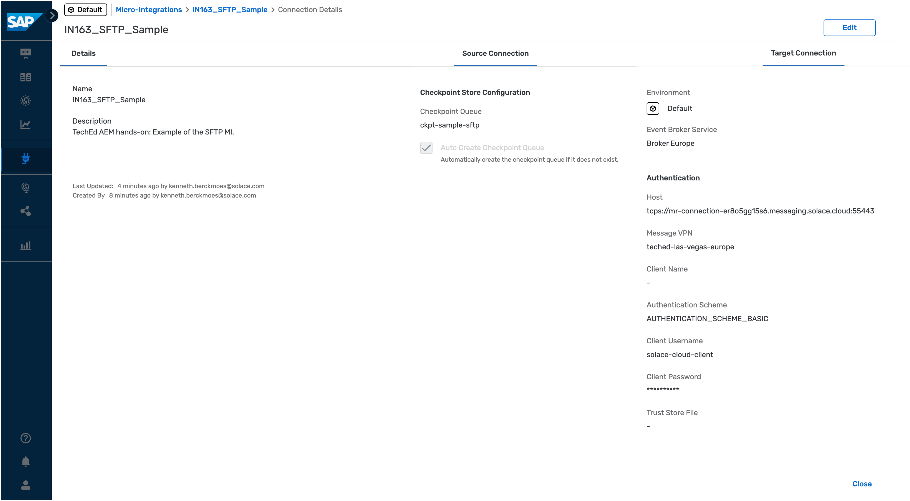

6. Go back to the overview of the SFTP Source Micro-Integration. On the top of the page, you can easily navigate back to your MI.

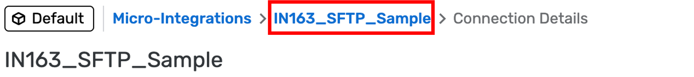

7. As mentioned before, on the right side of the page, you can see the flows. A flow defines a single data path through the Micro-Integration. 
Each flow specifies:
* source and target endpoints, such as queue, topic endpoint, or vendor-specific destination (e.g. SFTP Server URI, credentials and Delimited File Configuration)
* optionally, error handling, including dead message queue routing and retry settings
* optionally, header and payload mappings

The following diagram shows an example of a source Micro-Integration that contains two flows. The flows share the source and target connection configurations; the flows consist of individual endpoints and mappings (the diagram does not show error configuration).

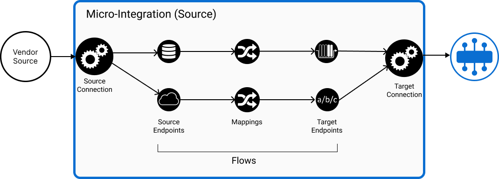

Feel free to open flow "IN163_sample_csv_to_events", to see how this diagram translates to practice.

Every Micro-Integration comes with five flows. So for the example of the SFTP Source Micro-integration, these flows can listen to their own SFTP server or directory/folder and map different objects, for example,
* 5 flows that listen to the same SFTP server but each to a different directory. One listens to the directory /salesorders and maps sales order objects, another that listens to /businesspartners and maps business partner objects, etc.: _in this case you require 1 Micro-Integration_.
* 5 flows that each listen to a different SFTP server and all map and publish sales order objects: _in this case you require 1 Micro-Integration_.
* 10 flows that listen to the same SFTP server, but map different objects: _in this case you require 2 Micro-Integrations_

Now, let's create our own Micro-Integration! In the next part of the exercise you will configure and deploy your own SFTP Source Micro-Integration.

## 7.4 - Configuring and deploying a flow in an SFTP Source Micro-Integration

Now that you are familiar with the structure of Micro-Integrations, it is time to configure and deploy your own.

Because we are using an SFTP Source Micro-Integration, we need an SFTP server from which it can retrieve files.

For this exercise, we will use <a href="https://sftpcloud.io/tools/free-sftp-server" target="_blank">sftpcloud.io</a> to set up a temporary SFTP Server and <a href="https://www.filestash.app/sftp-client.html" target="_blank">Filestash</a> as SFTP Client to upload files to the server.

### 7.4.1 - Create the SFTP Source Micro-Integration Micro-Integration

When creating a Micro-Integration, you need the credentials of the broker you are deploying the Micro-Integration to. 
That's why, in this exercise, we will first copy these credentials, then we will create the Micro-Integration.

1. In SAP Integration Suite, advanced event mesh, go to "**Cluster Manager**".

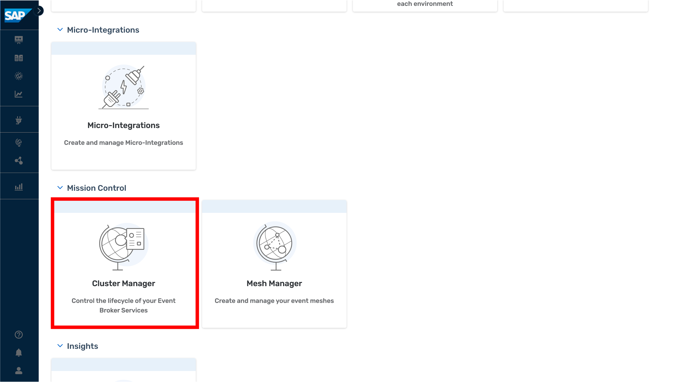

2. Go to the following broker: **Broker Europe**

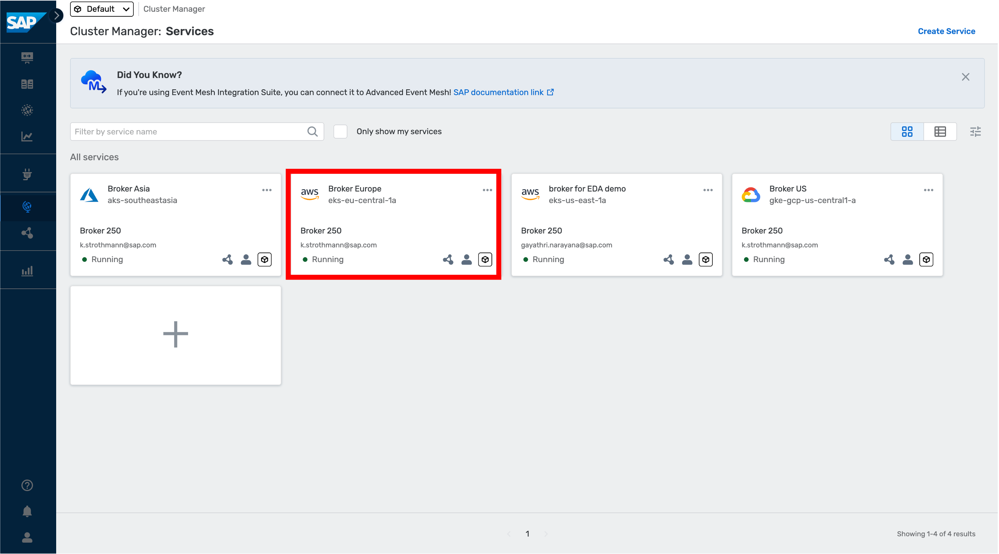

3. Go to the "**Try Me!**" tab.

4. **Copy the Client Password.** and paste it into a notepad.

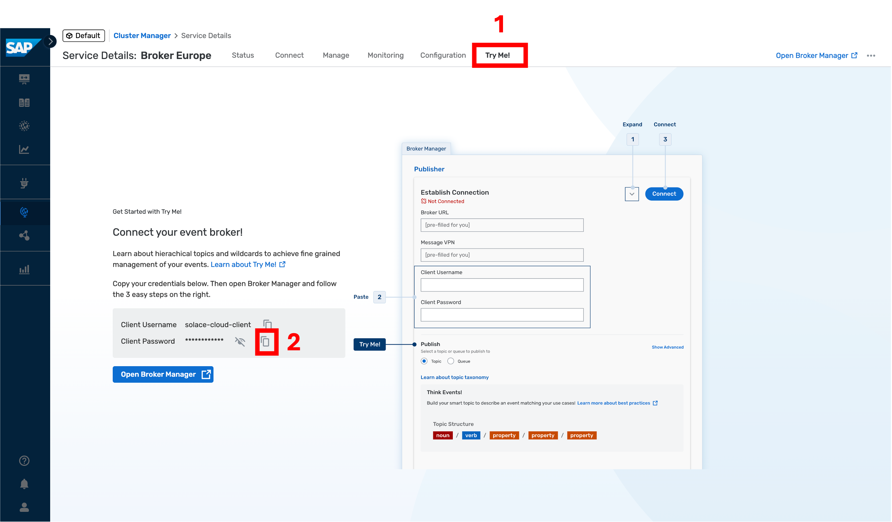

5. Now, go back to **Micro-Integrations**.
6. Click on "**Create Micro-Integration**".

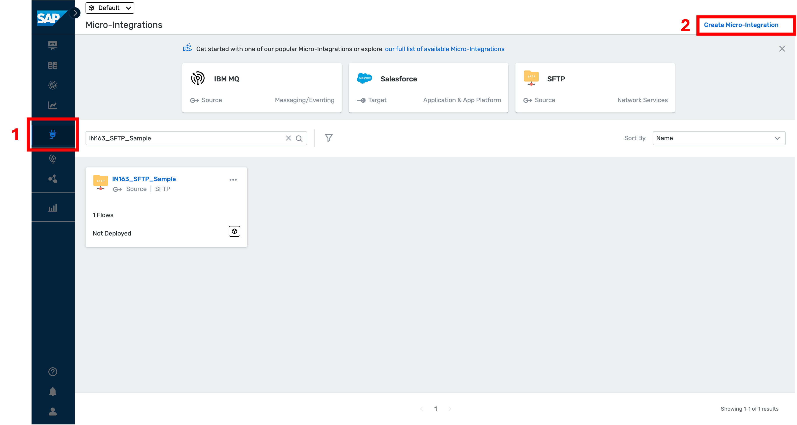

7. Search for the **SFTP** Micro-Integrations.

8. Select "**SFTP Source Miro-Integration**".

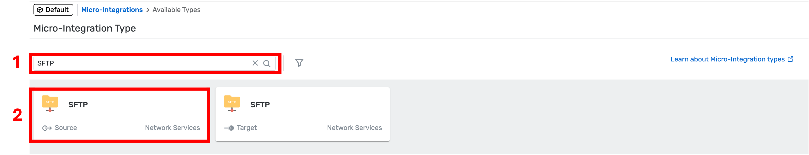

9. Enter the following name and description:
* **Name:** IN163_Retail_SFTP_\[userID\]
* **Description:** SAP TechEd hands-on – Create and deploy your own flow to read retail sales data from an SFTP server and publish events to the Advanced Event Mesh.

10. Click on "**Next**".

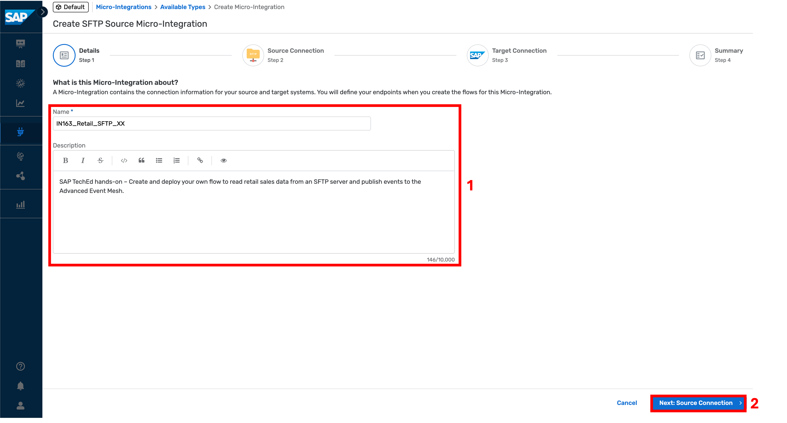

11. Enter the following name for your checkpoint queue: ckpt-sftp-retail-\[userID\]

12. **Check** the box: "**Auto Create Checkpoint Queue**"

13. At deployment, the system will check whether the checkpoint queue has been created. If it hasn't been created, it will automatically create the checkpoint queue. Click on "**Next**". 

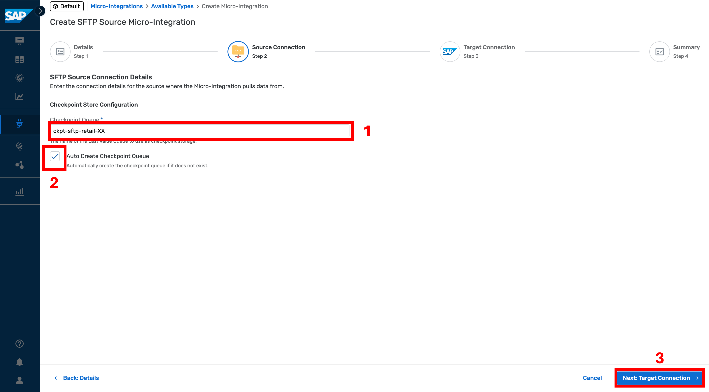

14. Select the following broker under **"Event Broker Service": Broker Europe**

15. Scroll down to "**Client Username**" and enter the following username: **solace-cloud-client**

16. Enter the client password copied from the "Try Me!" tab under "**Client Password**", and click "**Next**".

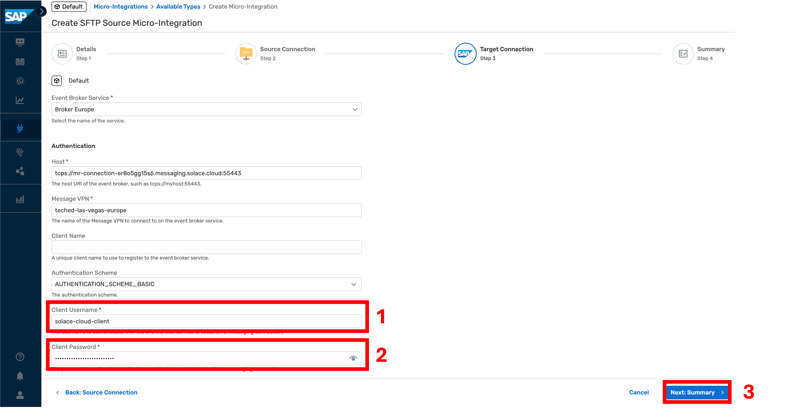

17. At the summary, review the details and click "**Create**".

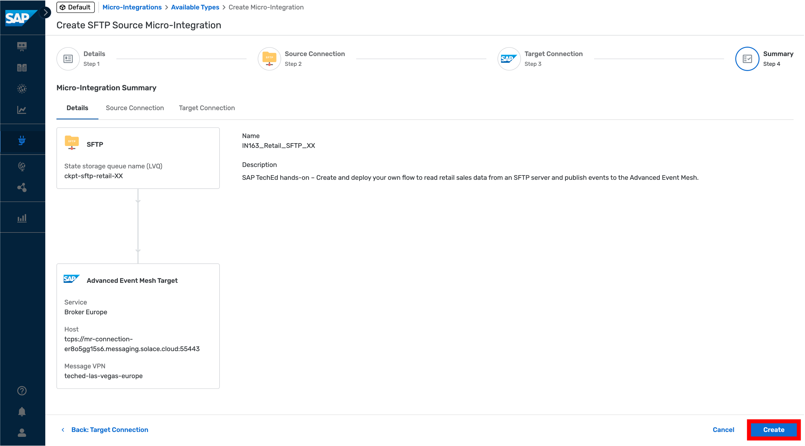

You should now see that the Micro-Integration is created. A pop-up appears asking us to create a flow, that will be done later in the exercise. In order to create a flow, we need credentials of an SFTP server, so let's first create a temporary SFTP server.

### 7.4.2 - Create a temporary SFTP Server

1. Go to <a href="https://sftpcloud.io/tools/free-sftp-server" target="_blank">sftpcloud.io</a>.
2. Click on "**Create test SFTP Server**".
This creates a test SFTP Server that is available for one hour. This should be enough for the duration of this hands-on exercise.

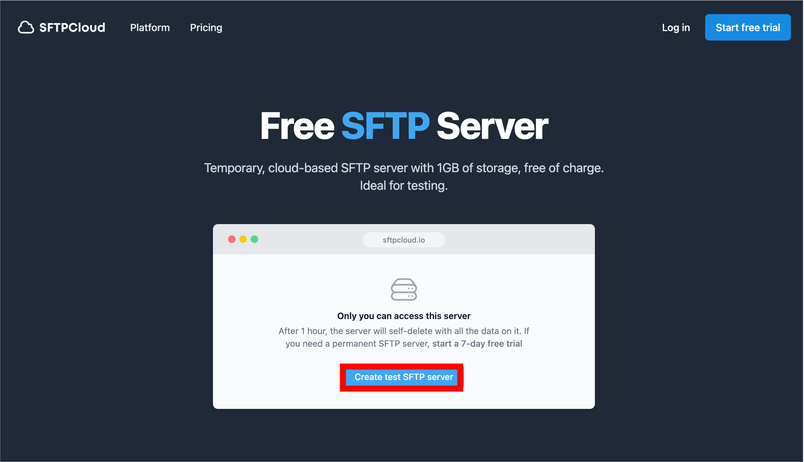

3. After the creation, you see an overview of:
* Host
* Port
* Username
* Password 

**NOTE**: Keep this tab open or copy these credentials to a notepad, we will need them very soon.

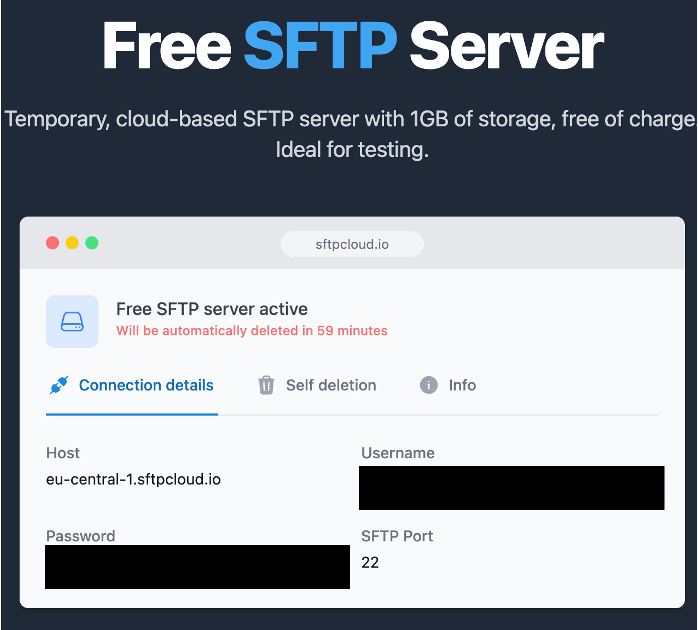

Now that we have our SFTP server, we're ready to create the flow in our Micro-Integration.

### 7.4.3 - Configure and deploy the flow

1. Go back to Micro-Integrations in SAP Integration Suite, advanced event mesh and search for the SFTP Source Micro-Integration that you created.

2. Open the SFTP Source Micro-Integration.

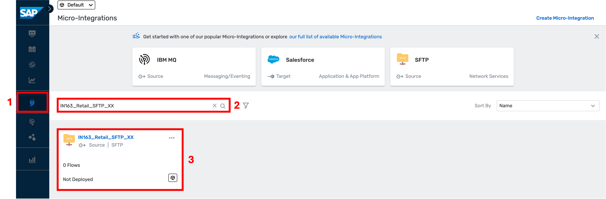

3. On the right side of the page, under "**Flows**", click "**Create Flow**"

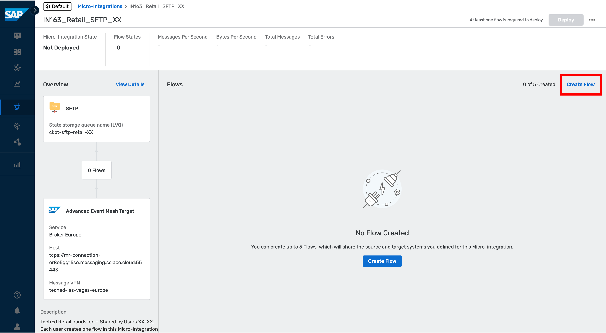

4. Enter a **unique name** and a description for your flow, for example,
* **Name**: IN163_handson_\[userID]\_csv_to_events
* **Description**: Reads each new or updated sales CSV from the SFTP inbound folder, splits it into individual rows, maps every row to a JSON event

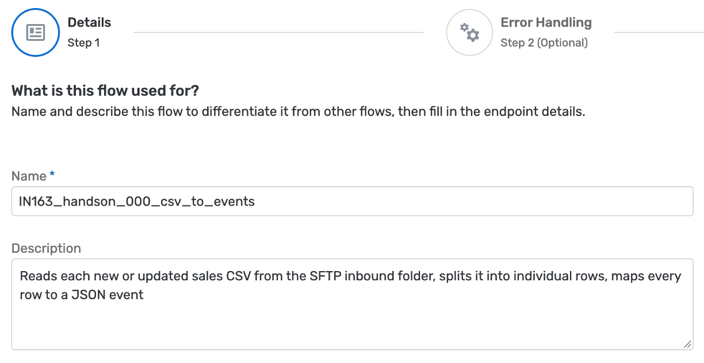

5. Scroll down to “Source Endpoint” and add your SFTP Server URI in the format: **sftp://\<host\>:\<port\>/upload/retail/sales/inbound**

6. Enter the username and password of the SFTP server created in step 2

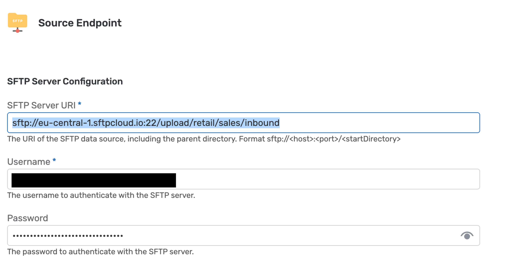

7. Scroll down again and use the following delimiter file configuration:
* **Event delimiter:  \n**
* **Field delimiter: ,**

**NOTE**: This means that an event will be created for each line in the CSV file, with fields separated by a comma \(,\).

8. Scroll to Target Endpoint and enter the following Topic Name:
**retail/sales/lineitem/recorded/v1**

**NOTE**: For this use case, we will use content-based topics. However, because the topic field is mandatory, the topic name entered here serves as a placeholder.

9. Click "**Next: Error Handling**"

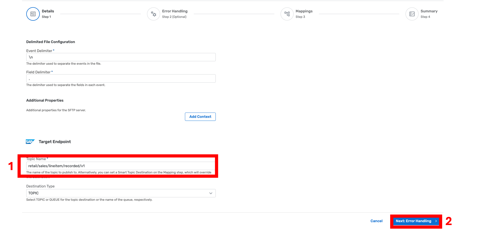

10.  Optionally, you can enable retries and a Dead Message Queue (DMQ) here. Click “**Next: Mappings**”.

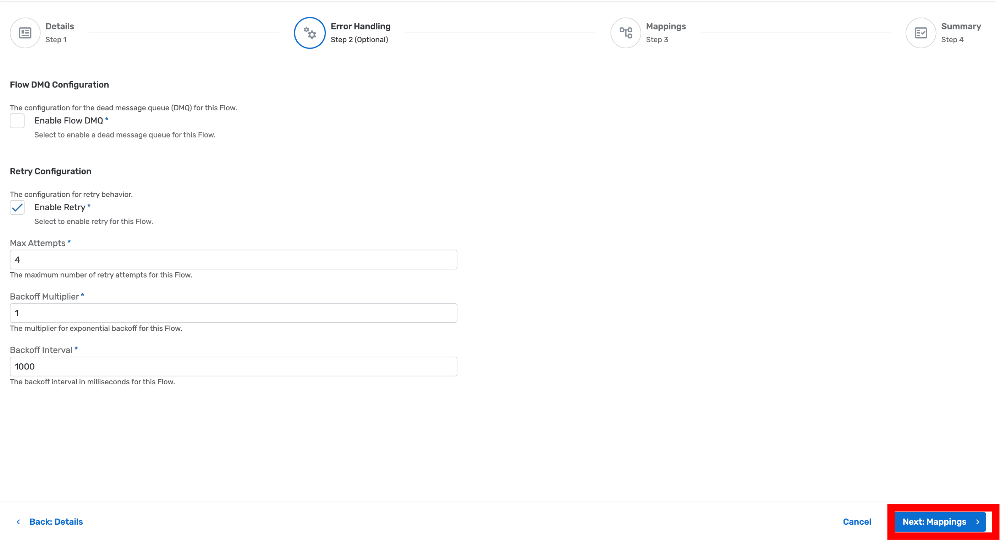

11. We can now create a mapping. You’ll see a title that says, “No Source Payload”, under this title click on “**Import File**” and import the file [retail_sales_events.json](materials/retail_sales_events.json).
Next, import the same file for the target payload. We are not going to focus on the message mapping in this example, we'll focus on the content-based topics instead.

**Note**: Even though we upload CSV files later, the Micro-Integration automatically converts them to a JSON structure.

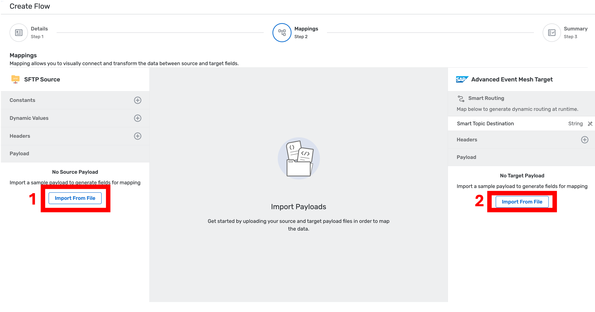

12. After the files are uploaded, we are going to do the message mapping using AI. Click on the button "**Map with AI**".

13. A pop-up appears asking for instructions. No need to enter any instructions, just click "**Map**".

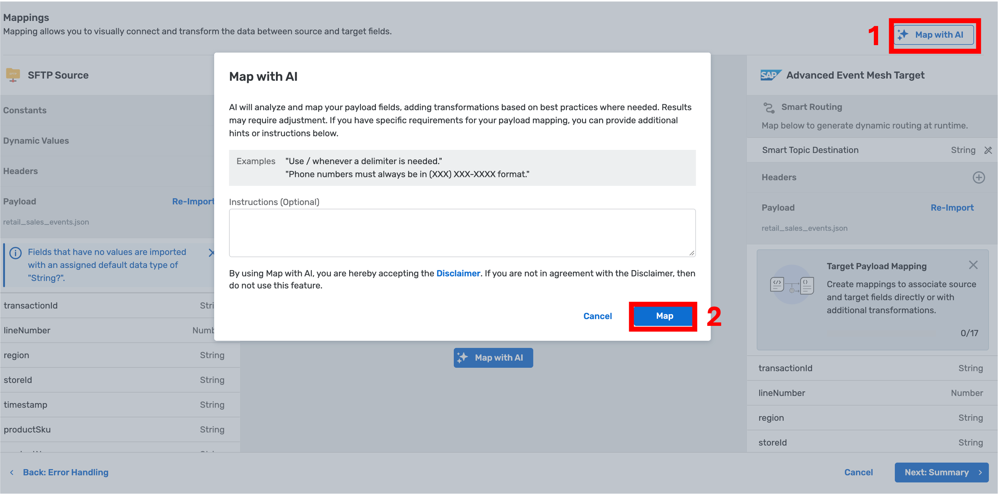

**This usually takes a few seconds or minutes. Once the AI is done, you should see a message saying that all target fields are mapped.**

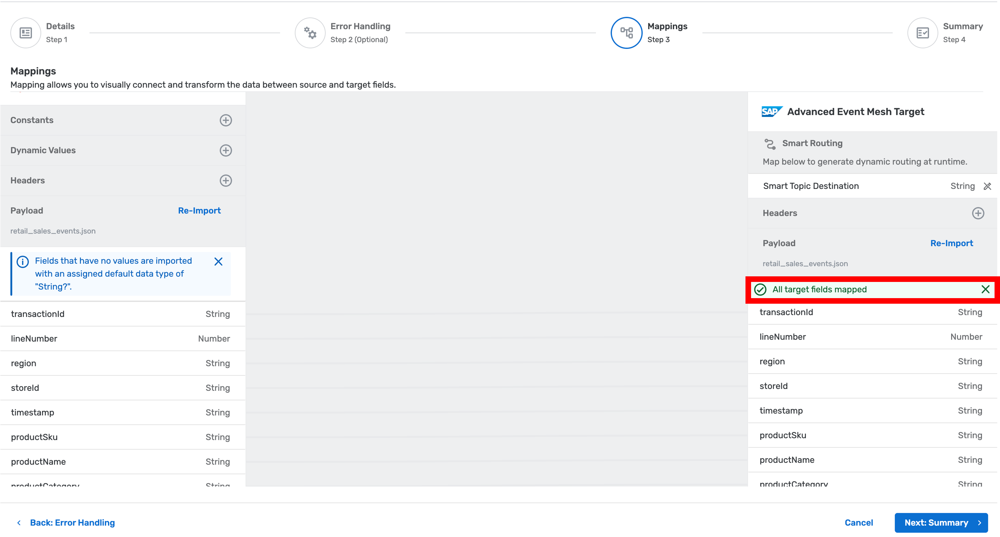

14. Once the mapping is complete, we will construct the topic using the Smart Topic Destination. This allows you to build a topic taxonomy based on the payload of your message. The topic that we will construct will look like this:

**retail/sales/lineitem/recorded/{userID}/{region}/{storeId}/{productCategory}/{transactionId}**

As you see, it is a combination of fixed values (retail/sales/lineitem/recorded/userID/) and the payload. In the next step, we will create these constants/fixed values.

15. Hover to the left side of your screen, and click on the “**+**” button next to “**Constants**”, under “**SFTP Source**”, and add the following constants:
* **First levels of the topic taxonomy:**
**Data Type**: String
**Constant Value**: retail/sales/lineitem/recorded/_\[userID]\_

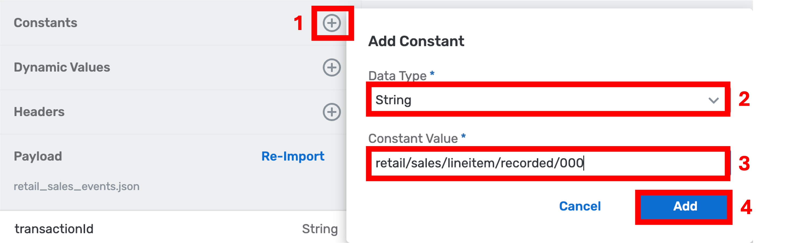

* **Separator:**
* **Data Type**: String
* **Constant Value**: /

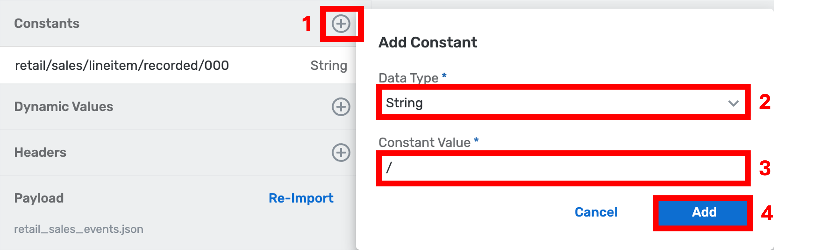

16. Drag a line **from retail/sales/lineitem/recorded/_\[userID]\_ to “Smart Topic Destination”** and click on “**Add transformation**”.

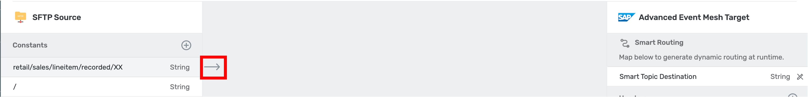

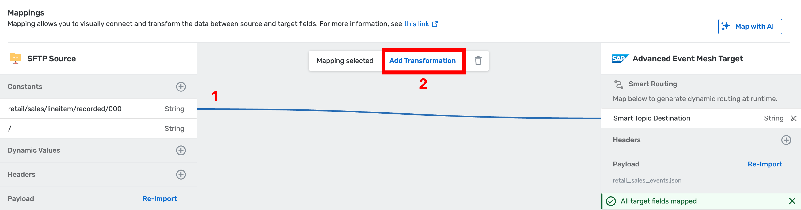

17. Use the **Concatenate** function and build a transformation that looks like this (use “**Add input**” to add fields):
* retail/sales/lineitem/recorded/_\[userID]\_
* /
* region
* /
* storeId
* /
* productCategory
* /
* transactionId

**NOTE: Ensure there are no double slashes (//) and that the topic does not end with a slash (/).**

18. Click "**Apply**", then click "**Next: Summary**".

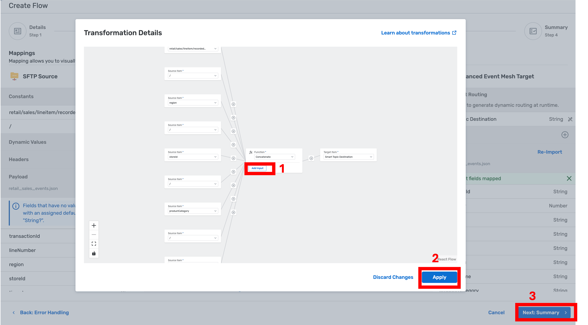

19. Click "**Create**".

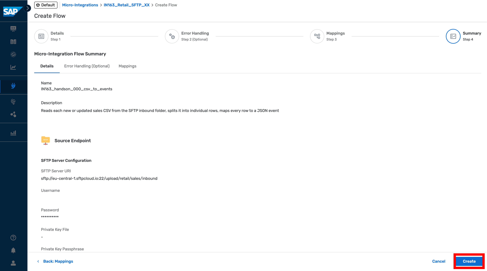

20. Now, you should see that your flow has been added to the Micro-Integration. To deploy the flow, you need to deploy the Micro-Integration. You do that by clicking on the "**Deploy**" button at the top right of the page. A pop-up will appear to confirm the deployment. Confirm by clicking on "**Deploy**" once more.

**NOTE**: If somebody else already deployed their flow, you need to first undeploy and then redeploy the Micro-Integration. **Before doing that, please inform one of the instructors!**

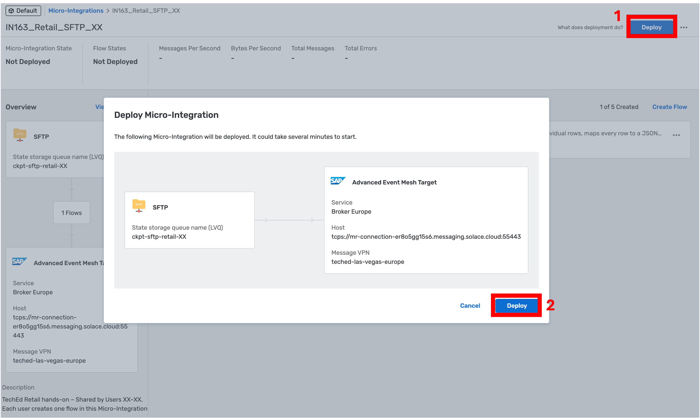

21. After the deployment, you should see that the flow is running successfully.

### 7.4.4 - Testing your Micro-Integration flow

In the previous section, we configured our SFTP Source Micro-Integration to retrieve files from an SFTP server.
As soon as a CSV file is uploaded to the SFTP server (in the specified folders), every line will be published as an event to the Smart Topic Destination we defined in the message mapping.
In this exercise we are going to subscribe to this Smart Topic Destination to see if we receive the events.

1. In the Cloud Console of SAP Integration Suite, advanced event mesh, go to "**Cluster Manager**".

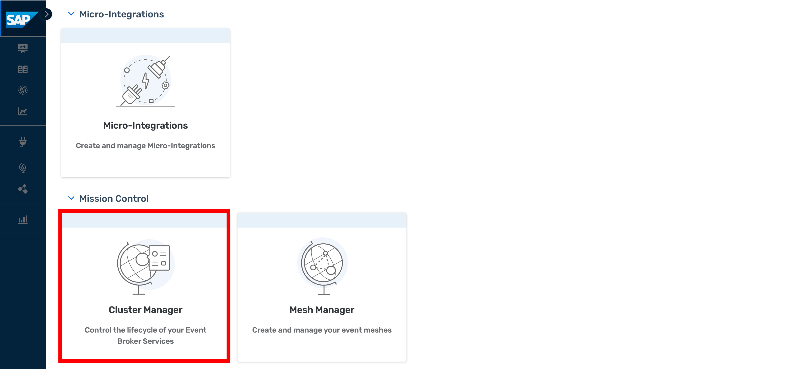

2. Go to the following broker: **Broker Europe**.

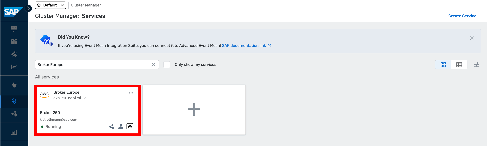

3. Go to the “**Try Me!**” tab, **copy the client password** and click on “**Open Broker Manager**”.

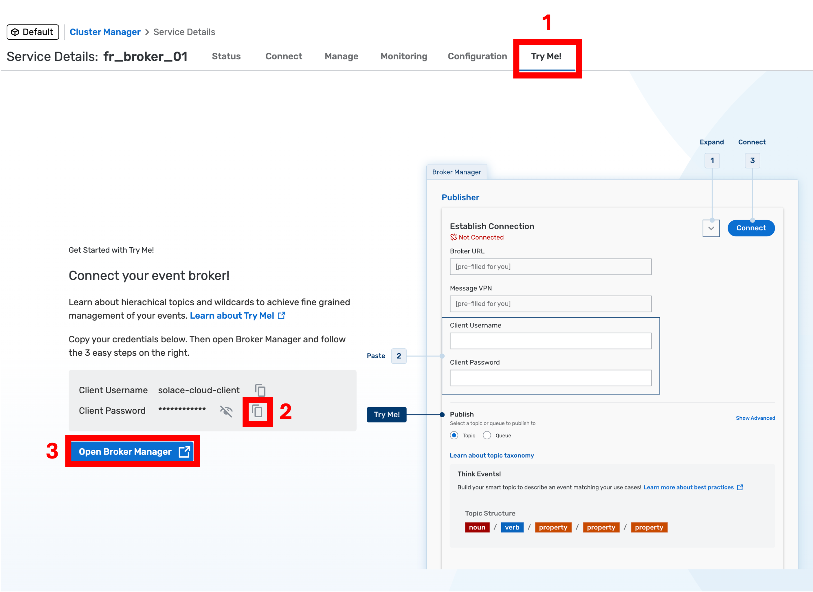

4. **Enter the client password** on the left side of the screen.

5. Copy and paste the following connection details:
* **Broker URL:** wss://mr-connection-er8o5gg15s6.messaging.solace.cloud:7443
* **Message VPN:** teched-las-vegas-europe
* **Client Username:** solace-cloud-client

6. **Hit “Connect” on both the “Publisher” and “Subscriber” side.**

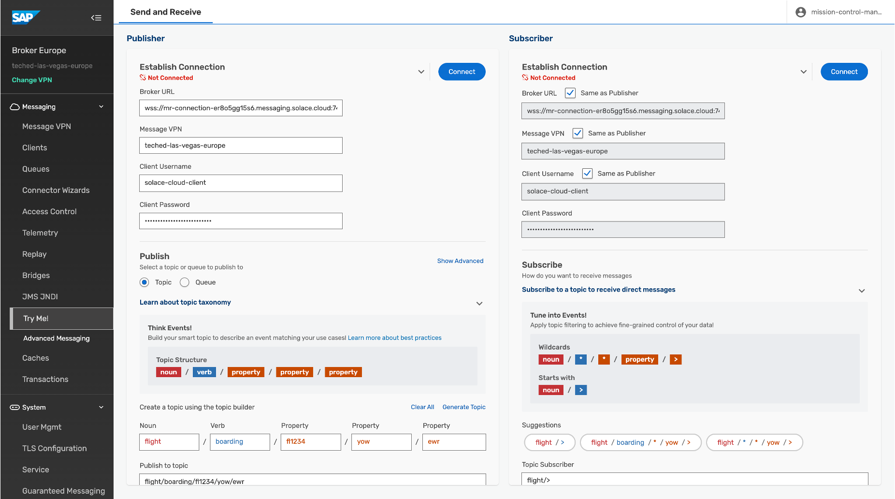

7. Subscribe to one (or more) of the following topics:
* retail/sales/lineitem/recorded/\[userID]\/>
* retail/sales/lineitem/recorded/\[userID]\/emea/store-042/>
* retail/sales/lineitem/recorded/\[userID]\/*/*/beverages/>

**NOTE**: We're making use of <a href="https://help.pubsub.em.services.cloud.sap/Messaging/Wildcard-Charaters-Topic-Subs.htm" target="_blank">wildcards</a> for topic subscription.

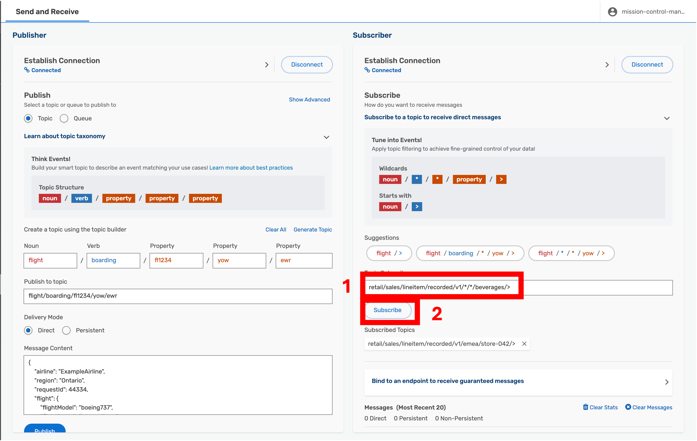

8. Let's publish a CSV file as events, go to <a href="https://www.filestash.app/sftp-client.html" target="_blank">Filestash</a>, enter the connection details of the SFTP Server you created with <a href="https://sftpcloud.io/tools/free-sftp-server" target="_blank">sftpcloud.io</a>, and click "**Connect**".

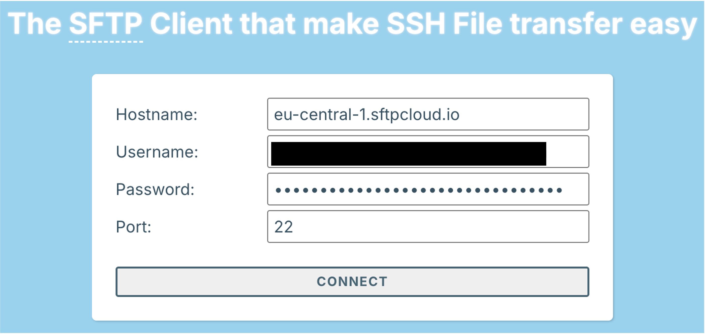

9. You should see the following folder structure: **/upload/retail/sales/inbound**. This was created by the Micro-Integration flow we created in step 3.

**NOTE**: During the setup of the MI, we specified the folder structure. The moment we deployed the flow, it connected to the SFTP Server and looked for the folders. It didn’t find these folders, so it created them.

10. Click through until you are in the folder “inbound”.

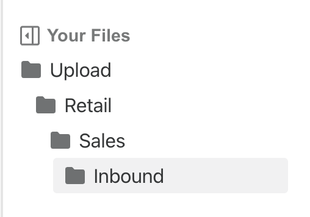

11. Download the file [retail_sales_sample.csv](materials/retail_sales_sample.csv).

12. Upload the CSV file.

13. After uploading the file, return to the “**Try Me!**” tab. You should see each CSV lines arriving as separate events. 

Feel free to play around with the file and topic subscriptions.

Congratulations! You have built a Micro-Integration flow that retrieves files from an SFTP server, converts each CSV row into a separate JSON event, and publishes the events to a Smart Topic Destination.

Applications can consume events through direct topic subscriptions or from queues. Queues provide durable message storage, helping prevent message loss when consumers are temporarily unavailable or slow.

As an optional step, you can go to the queue you created in Exercise 1 (or create your own queue), subscribe your queue to the Smart Topic Destination, add new rows to the CSV file and reupload it to the SFTP server. If you then bind to the queue (e.g. from "Try Me!" tab or the external consumer app from Exercise 1), your consumer will now receive the events via the queue.

### 7.4.5- Troubleshooting

If issues occur:
1. Check if the SFTP server is still active (it expires after one hour).
2. Verify the SFTP credentials.
3. Ensure there are no double slashes (//) in the Smart Topic Destination or the topic doesn't end with a slash (/).

You can view logs via Micro-Integrations &rarr; Select your SFTP Source MI &rarr; three dots at the top right &rarr; View Error Logs

## 7.5 - Micro-Integration Licensing (Optional)

This is an optional section that explains in more detail how Micro-Integrations are licensed.

Micro-Integrations in SAP Integration Suite, advanced event mesh are available through two licensing models: 
* **Included with your AEM broker**: certain broker classes (starting with Broker 1K) include a predefined number of Micro-Integrations at no additional charge. These included Micro-Integrations cannot be shared across SAP BTP Subaccounts. The table below shows how many Micro-Integrations are included with each broker service class.

| Service Class (nr of Connections) | Nr. of Micro-Integrations Included |
| --- | --- |
| Broker 100 (Developer) | 0 |
| Broker 250 (Smallest Production Broker) | 0 |
| Broker 1K | 2 |
| Broker 5K | 5 |
| Broker 10K | 8 |
| Broker 50K | 15 |
| Broker 100K | 25 |

* **Pay by the hour**: Additional Micro-Integrations can be deployed to any broker size. In this case, you're charged for each hour an additional Micro-Integration is in the "**Deployed**" state.

Each Micro-Integration can contain up to five flows. If you require more than five flows, you need to leverage multiple Micro-Integrations.

For pricing and licensing details, visit the <a href="https://discovery-center.cloud.sap/serviceCatalog/advanced-event-mesh/?tab=service_plan&commercialModel=cpea&region=all&service_plan=standard" target="_blank">SAP Discovery Center</a>.

## Summary 

In this exercise, you explored how Micro-Integrations connect external systems directly to Advanced Event Mesh, enabling lightweight, high-volume integration scenarios.

You gained an understanding of:
* The Micro-Integrations that are available and the different types (Source, Target, Processor).
* How Micro-Integrations are created and how to configure their flows.
* Turning files into events by reading a CSV file from an SFTP server, converting each row into a JSON event, and publishing it to the mesh.
* Using content-based topics to route events based on their payload, allowing consuming applications to subscribe to the data they need.

The result? You transformed file-based data into individual JSON events, ready for your applications to consume through the mesh.
